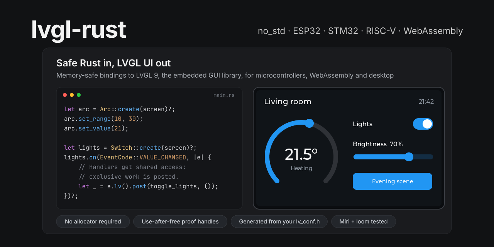

# lvgl-rust: safe Rust bindings for LVGL 9, the embedded GUI library



[](https://github.com/AlixANNERAUD/lvgl_rust/actions/workflows/ci.yml)
[](https://codecov.io/gh/AlixANNERAUD/lvgl_rust)
[](https://crates.io/crates/lvgl-rust)
[](https://docs.rs/lvgl-rust)
[](https://crates.io/crates/lvgl-rust-sys)
[](https://docs.rs/lvgl-rust-sys)
[](https://github.com/lvgl/lvgl)
[](documentation/reference/features.md)
[](Cargo.toml)
[](LICENSE)

**Build embedded user interfaces in safe Rust with [LVGL](https://lvgl.io) 9.**
One `unsafe impl` for your lock replaces `unsafe` on every call: `lvgl-rust` gives you safe, `no_std` Rust bindings to LVGL, the
most widely used open-source embedded GUI library: widgets, styles, events,
timers, animations, display and input drivers, for microcontrollers (ESP32,
STM32, nRF, RP2040, RISC-V), embedded Linux, WebAssembly and desktop
simulators. The bindings are generated at build time from your own
`lv_conf.h`. Dangling objects are ruled out: a view kept across a call
that may delete objects is a compile error, and a handle to a deleted
object returns `Error::Dead`.

| At a glance | |
| --- | --- |
| Safety | No dangling objects: views borrow the session, deletion needs exclusive access, handles report deleted objects. Checked by a compile-fail suite, Miri, loom and AddressSanitizer in CI |
| Heap | **None required.** Without feature `heap`, lvgl-rust allocates nothing: drivers, styles and handlers live in `static`s. With it, closures and owned images go on LVGL's own heap |
| Locking | **None.** You bring the lock; the crate takes a proof that you hold it |
| Speed | A setter through a view costs the same as the raw C call (**1.7 ns** both); an event reaches a Rust closure **1.6 to 2.7 ns** later than a raw C callback ([measured](documentation/reference/overhead.md) on the host) |
| Size | **4498 B** of code and **188 B** of `.bss` on a Cortex-M0 (`thumbv6m-none-eabi`) with 16 handle slots, 1.9 % of the test firmware's text ([measured](documentation/reference/overhead.md)) |
| LVGL | 9.6.0, compiled from source by Cargo for your configuration |
| Targets | Cortex-M0 to M33, RISC-V, WebAssembly and Linux, each built in CI (see [Supported platforms](#supported-platforms)) |

## Why lvgl-rust?

LVGL is a C library: objects are raw pointers, deleting a parent deletes its
children behind your back, and an event handler that deletes the object
being dispatched is a use-after-free. Wrapping it naively in Rust keeps
those bugs and hides them behind safe-looking methods. `lvgl-rust` is
designed so that the compiler rules them out instead.

- **Sound by construction.** A view (`&Obj`, `&Label`) borrows the session,
  so it cannot outlive a call that may delete objects. Creating, deleting,
  cleaning and moving objects need exclusive access (`&mut Lvgl` or an
  `ObjMut`). `Handle`s (4 bytes) can be stored and sent between threads,
  and resolve to `Error::Dead` once the object is gone, whatever deleted it.
  Which LVGL function needs which access is decided by an audit of LVGL's
  own call graph, not by hand. See [the access model](documentation/explanation/access-model.md).
- **No allocator required.** The core and the generated wrappers allocate
  nothing. Constant styles (`const_style!`), images, button maps and grid
  templates stay in flash. Closures and owned images go on LVGL's own heap
  only with feature `heap`.
- **No locking.** The crate never takes a lock: you implement `LvglAccess`
  on the guard of the lock you already have (a `std` mutex, an RTOS mutex,
  a critical section) and get a `Session`. Event handlers run with shared
  access; work that needs exclusive access is deferred with `delete_later`
  and `lv.post(f, data)`.
- **Generated for your `lv_conf.h`.** `lvgl-rust-sys` compiles LVGL for your
  configuration, and `lvgl-rust`'s build script generates the safe API from
  those exact bindings: every enabled widget (29 with the vendored
  configuration) gets typed methods, disabled ones are absent, and anything
  not wrapped yet stays reachable through `lvgl_rust::sys`.
- **Small, measured overhead.** Shared setters are the raw call, resolving a
  handle costs 2.4 ns on the reference machine, and a session is
  zero-sized. Every number is regenerated by `mise run overhead` and
  published in [the overhead reference](documentation/reference/overhead.md).

## Quick start

Add the safe crate (until the first crates.io release, use
`{ git = "https://github.com/AlixANNERAUD/lvgl_rust" }`):

```toml
[dependencies]
lvgl-rust = "0.1"
```

Point `DEP_LV_CONFIG_PATH` at the directory of your `lv_conf.h`, for example
in `.cargo/config.toml`, and enable the OBJ_ID hooks the handles rely on:

```toml
[env]
DEP_LV_CONFIG_PATH = { value = "lvgl-configuration", relative = true }
```

```c
#define LV_USE_OBJ_ID 1
#define LV_OBJ_ID_AUTO_ASSIGN 1
#define LV_USE_OBJ_ID_BUILTIN 0
```

Then create a display, a button and a label, and react to clicks:

```rust,ignore
use lvgl_rust::{
    Display, DisplayCell, DrawBuf, DrawBuffers, Error, Flush, FlushRequest, Lvgl, LvglAccess,
    RenderMode, WidgetExt,
    enums::EventCode,
    tick_inc,
    widgets::{Button, Label},
};
use std::sync::{Mutex, MutexGuard};
use std::time::Duration;

/// The lock that serializes every LVGL call, and the proof of holding it.
static LVGL: Mutex<()> = Mutex::new(());
struct Guard(#[allow(dead_code)] MutexGuard<'static, ()>);
// SAFETY: every LVGL call of the program holds this mutex.
unsafe impl LvglAccess for Guard {}

/// The display driver: sends rendered areas to the panel.
struct Panel;
impl Flush for Panel {
    fn flush(&mut self, mut req: FlushRequest<'_>) {
        let area = req.area();
        let pixels = req.pixels();
        // Send `pixels` for `area` to the panel (SPI, DMA, a window, ...).
        // Returning tells LVGL the buffer is free again.
        let _ = (area, pixels);
    }
}
static PANEL: DisplayCell<Panel> = DisplayCell::new();
static BUFFER: DrawBuf<{ 320 * 2 * 24 }> = DrawBuf::new(); // 24 rows of RGB565

fn main() -> Result<(), Error> {
    {
        let mut guard = Guard(LVGL.lock().unwrap());
        let mut lv = lvgl_rust::init(&mut guard)?;
        let _display = Display::create(
            &mut lv, &PANEL, Panel, 320, 240,
            DrawBuffers::single(&BUFFER), RenderMode::Partial,
        )?;

        // Creating needs exclusive access to the parent: the active screen.
        let mut screen = lv.screen_active_mut().expect("the display has a screen");
        let button = Button::create(&mut screen)?.handle()?; // Handle<Button>, storable
        let mut button = button.get_mut(&mut lv)?;           // ObjMut<Button>
        button.set_size(120, 50);
        button.center();
        let label = Label::create(&mut button)?;             // &Label, borrows `button`
        label.set_text_str("Press me")?;
        let label = label.handle()?;

        // Handlers get shared access: they can change text, not delete objects.
        button.view().on_with(EventCode::CLICKED, label, |e, label| {
            if let Ok(label) = label.get(e.lv()) {
                let _ = label.set_text_str("Clicked");
            }
        })?;
    }

    loop {
        let mut guard = Guard(LVGL.lock().unwrap());
        tick_inc(5);
        let mut lv = Lvgl::enter(&mut guard)?;
        let wait = lv.timer_handler();
        drop(lv);
        drop(guard);
        std::thread::sleep(Duration::from_millis(u64::from(wait.min(5))));
    }
}
```

The [first application tutorial](documentation/tutorials/first-application.md)
walks through this program step by step, and the desktop example
(`mise run example`, [`lvgl-rust/examples/desktop.rs`](lvgl-rust/examples/desktop.rs))
puts most of the API together: drivers in statics, a clock bound to a
subject, windows with close buttons, a textarea and a keyboard, styles, a
timer and an animation.

## Crates

| Crate | What it is | Use it when |
| --- | --- | --- |
| [`lvgl-rust`](lvgl-rust) | Safe, `no_std` bindings, generated at build time for your `lv_conf.h` | You write an application or a driver in Rust |
| [`lvgl-rust-sys`](lvgl-rust-sys) | Raw `no_std` FFI bindings: compiles LVGL from source with `cc`, binds it with bindgen and exports the build configuration to dependent crates | You need the C API as is, or compile C code (fonts, drivers) against the same headers |
| [`lvgl-rust-gen`](lvgl-rust-gen) | Host-only generator and access audit used by `lvgl-rust`'s build script | Never directly |

Raw and safe code can live side by side: `lvgl_rust::sys` re-exports
`lvgl-rust-sys`, so a code base can move over one module at a time
([migration guide](documentation/how-to-guides/migrate-from-raw-bindings.md)).

## Supported platforms

| Target | Example hardware | Checked in CI |
| --- | --- | --- |
| `thumbv6m-none-eabi` | Cortex-M0/M0+: RP2040, STM32F0, nRF51 | `lvgl-rust` firmware, with its size budget |
| `thumbv7em-none-eabihf` | Cortex-M4F/M7: STM32F4, STM32H7, nRF52840 | `lvgl-rust` firmware, with handles and views only |
| `thumbv8m.main-none-eabihf` | Cortex-M33: nRF5340, STM32U5 | `lvgl-rust` firmware |
| `riscv32imc-unknown-none-elf` | ESP32-C3 and other RV32IMC cores | `lvgl-rust-sys` build and `lvgl-rust` firmware, with its size budget |
| `wasm32-unknown-unknown` | Browsers, without a C library | Build of both crates |
| `wasm32-wasip1` | WASI runtimes | Tests and the desktop example, run under wasmtime |
| Linux host (`x86_64`) | Desktop simulators, embedded Linux | Full test suite, ASan, Miri, loom |
| `*-emscripten` | Browsers, with Emscripten | Supported by the build script (`EMSDK`), not built in CI |
| Xtensa (ESP32, ESP32-S3) | ESP-IDF or bare metal | Not built in CI: the build script derives clang's triple from Cargo's target |

How to set up the C toolchain for each target:
[build for embedded targets](documentation/how-to-guides/build-for-embedded-targets.md)
and [supported targets](documentation/reference/supported-targets.md).

## Documentation

The [documentation](documentation/README.md) follows the
[Diátaxis](https://diataxis.fr) structure.

| | |
| --- | --- |
| **Tutorial** | [Your first application](documentation/tutorials/first-application.md) |
| **How-to guides** | [Configure LVGL](documentation/how-to-guides/configure-lvgl.md), [share LVGL between threads](documentation/how-to-guides/share-lvgl-between-threads.md), [write a display driver](documentation/how-to-guides/write-a-display-driver.md), [write an input driver](documentation/how-to-guides/write-an-input-driver.md), [handle events](documentation/how-to-guides/handle-events.md), [use the heap](documentation/how-to-guides/use-the-heap.md), [receive events asynchronously](documentation/how-to-guides/receive-events-asynchronously.md), [build for embedded targets](documentation/how-to-guides/build-for-embedded-targets.md), [reduce the footprint](documentation/how-to-guides/reduce-the-footprint.md), [migrate from raw bindings](documentation/how-to-guides/migrate-from-raw-bindings.md), [use external fonts](documentation/how-to-guides/use-external-fonts.md) |
| **Explanation** | [Access model](documentation/explanation/access-model.md), [object lifetime](documentation/explanation/object-lifetime.md), [event handlers](documentation/explanation/event-handlers.md), [generated bindings](documentation/explanation/generated-bindings.md), [overhead](documentation/explanation/overhead.md) |
| **Reference** | [API overview](documentation/reference/api-overview.md), [features](documentation/reference/features.md), [build configuration](documentation/reference/build-configuration.md), [errors](documentation/reference/errors.md), [supported targets](documentation/reference/supported-targets.md), [overhead measurements](documentation/reference/overhead.md), [development tasks](documentation/reference/development-tasks.md) |

The API documentation is on [docs.rs](https://docs.rs/lvgl-rust).

## Frequently asked questions

**How do I use LVGL from Rust?** Add `lvgl-rust`, point `DEP_LV_CONFIG_PATH`
at your `lv_conf.h` and follow the [quick start](#quick-start). Cargo
compiles LVGL from source; you need a C compiler for your target and
`libclang` for bindgen.

**Does it work without `std` or an allocator?** Yes. Both crates are
`#![no_std]` and `lvgl-rust` allocates nothing. LVGL itself uses the heap
your `lv_conf.h` selects (its builtin one by default), or a Rust allocator
with feature `allocator`.

**Can I keep my existing raw LVGL code?** Yes. The safe crate builds on
`lvgl-rust-sys` without changing it; `as_ptr()` and `Obj::from_raw` cross
between the two while you migrate.

**What does the safety cost?** A few nanoseconds per handle resolution or
event, nothing per setter through a view, and a few kilobytes of flash. See
[the measurements](documentation/reference/overhead.md) and
[where the costs come from](documentation/explanation/overhead.md).

## Contributing

Issues and pull requests are welcome. The repository uses
[mise](https://mise.jdx.dev) for the toolchain and for tasks that mirror CI:

```sh
git submodule update --init --recursive
mise install
mise run check      # format, clippy, the fast tests and the lvgl-rust tests, as before a push
mise tasks          # every task: tests, cross builds, size gate, audit, ...
```

[Development tasks](documentation/reference/development-tasks.md) describes
each task, and [`AGENTS.md`](AGENTS.md) the architecture and the rules for
changes. Commit messages follow `type: summary` (`feat:`, `fix:`, `docs:`, ...).

## License

MIT, see [LICENSE](LICENSE). LVGL is distributed under its own
[MIT licence](https://github.com/lvgl/lvgl/blob/master/LICENCE.txt).

---

Developed by [Alix ANNERAUD](https://alix.anneraud.fr).
